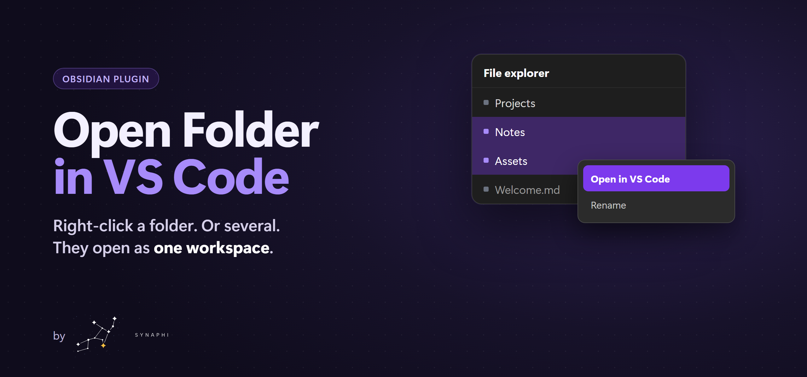

<a href="assets/banner.png"></a>

# Open Folder in VS Code

Right-click a folder in the file explorer and open that folder in Visual Studio Code.

**One job, done well.** The folder you clicked becomes the workspace. Not the whole vault, and not the note you had open.

## Why you'll like it

- **The folder under the pointer.** One right-click, and Visual Studio Code opens with that folder as the workspace.
- **Several folders, one window.** Ctrl-click or Shift-click folders, then use the same command. They open together as one multi-root workspace.
- **Files stay put.** Notes in the selection are skipped. A folder selected twice is opened once. If one selected folder has no local path, nothing opens.
- **It finds Visual Studio Code.** A standard install, then the `code` command. Set a path in settings if the install lives somewhere else. A missing path is reported. It does not guess another one.
- **Your language.** The menu follows the display language. Korean, Japanese, Spanish, and the rest of the app language list are included. An unknown language falls back to English.

## How to use

1. In the file explorer, right-click a folder.
2. Choose **Open in VS Code** (한국어: **VS Code로 열기**).
3. To open more than one folder, select them first, then use the same command.

Desktop only. Windows, macOS, and Linux.

## Install

Install **Open Folder in VS Code** from Community plugins, then enable it.

Manual install: download `main.js`, `manifest.json`, and `styles.css` from the [latest release](https://github.com/Synaphi/open-folder-in-vscode/releases) into `.obsidian/plugins/open-folder-in-vscode/`, then enable the plugin.

## Develop

```bash
npm install
npm test
```

`npm test` typechecks, builds `main.js`, and runs the menu, language, and launch-argument checks. It does not open a Visual Studio Code window.

The banner is rendered from `assets/banner-source.html` with headless Chrome at 1280×600, scale 2.

## License

MIT
